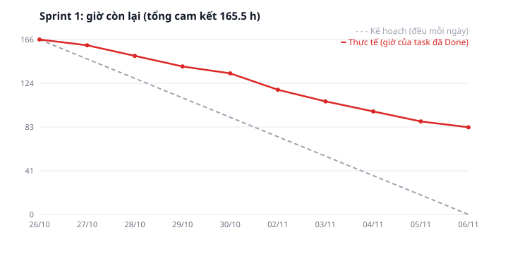

# Báo cáo tiến độ — Sprint 1

| Mục | Nội dung |
|---|---|
| Iteration trên Project | **Sprint 1** ([GitHub Project](https://github.com/users/anhnn-1576/projects/1), lọc `iteration:"Sprint 1"`) |
| Khoảng thời gian giả lập | 26/10/2026 (thứ Hai) → 06/11/2026 (thứ Sáu), 10 ngày làm việc |
| Thời điểm số liệu | Cuối ngày 06/11/2026 |
| Đội (người phụ trách giả định) | BE1, BE2 (backend) · FE1 (frontend) · QA1 · BrSE1. FE2 vào từ Sprint 2 |

Đây là sprint **giả lập** để minh hoạ cách vận hành Project và báo cáo. Ngày Done, trạng thái và các sự kiện trong phần diễn giải (ngày gửi câu hỏi, ngày code xong, nguyên nhân trễ) đều là kịch bản dựng, không phải tiến độ thật. Nguồn dữ liệu: [`backlog/sprint-plan.json`](backlog/sprint-plan.json). Board được cập nhật bằng [`scripts/apply-sprint-plan-to-github-project.py`](scripts/apply-sprint-plan-to-github-project.py), burndown vẽ bằng [`scripts/render-sprint-burndown.py`](scripts/render-sprint-burndown.py). Cả hai đọc cùng file dữ liệu đó.

**Tóm tắt:** Sprint 1 cam kết 28 task (97 SWP · 165,5 h). Đã xong 14 task (46 SWP · 83 h), tức **50 % số giờ**. Phần nền tảng mà các màn khác dựa vào đã xong: tệp chứng cứ, bảng thông báo, job mở ngày, mô hình dữ liệu tư cách, 4/6 bước tính 完納奨励金. Phần trễ nằm ở 3 chỗ: hàng đợi offline (#10), cổng review (#18), và chưa có câu trả lời nào của khách cho 8 nhóm câu hỏi. Theo tốc độ hiện tại, đợt này **không kịp kết thúc ở Sprint 3 (04/12)** nếu không tăng năng lực hoặc thu hẹp phạm vi (xem rủi ro R1).

## 1. Trạng thái

Phạm vi: 28 task lá của Sprint 1. SWP và giờ lấy từ [estimate.md](estimate.md).

| Trạng thái | Số issue | Tổng SWP | Ghi chú |
|---|---:|---:|---|
| Done | 14 | 46 | 83 h. #3, #4, #5, #7, #11, #12, #15, #16, #19, #53, #73, #74, #76, #77. Gồm tệp chứng cứ (DB, API, UI), bảng thông báo, job 02:00, trạng thái offline chuẩn (#11), mô hình tư cách và hàm kiểm theo căn cứ, form đăng ký người tham gia (#19, chạy với API hiện có của prototype, nối API mới khi #18 Done), test hồi quy sửa sau chốt, bước 1/2/4/5 của 完納奨励金 |
| In Review | 1 | 5 | 8,5 h. #18 (lưu hồ sơ + tư cách nguyên tử): code xong 04/11, chờ người review 2 ngày. AI review đã đạt, người review chưa đạt thì chưa tính Done |
| In Progress | 10 | 36 | 57 h. Code: #8 (worker SES), #10 (hàng đợi offline), #75 (bước 3: phiên bản quy tắc). Làm rõ: #86–#88, #90–#93 đã gửi khách 28/10, chưa có trả lời |
| Blocked | 1 | 3 | 4,5 h. #89 (C04: giao hàng trên ngày đã khoá). Khách cần hỏi lại bộ phận vận hành ở bến, chưa hẹn ngày trả lời. Chặn #58 và ảnh hưởng #69 ở Sprint 3 |
| Todo | 2 | 7 | 12,5 h. #20 (E2E đăng ký) chờ #18. #24 (UI đổi trạng thái tư cách) chưa bắt đầu vì FE1 dồn sức cho #10 |
| **Tổng Sprint 1** | **28** | **97** | **165,5 h** |

**Theo người phụ trách (giờ Done / giờ cam kết / năng lực):** BE1 32,5 / 41 / 40 · BE2 25,5 / 41 / 40 · FE1 18 / 36,5 / 40 · QA1 7 / 11 / 20 · BrSE1 0 / 36 / 36. BE1 và BE2 nhận vượt năng lực 1 h. Đây là một phần lý do Sprint 2 cần cam kết theo tốc độ thật (R1).

**Toàn backlog:** 67 task lá · 250 SWP · 434 h. Đã Done 83 h (19 %). Sprint 2 đã lên kế hoạch 20 task (79 SWP · 138,5 h), Sprint 3 có 19 task (74 SWP · 130 h). 14 task chưa xong của Sprint 1 (51 SWP · 82,5 h) sẽ chuyển sang Sprint 2 ở buổi planning ngày 09/11.

## 2. Burndown

| Ngày | Kế hoạch còn lại (h) | Thực tế còn lại (h) | Lệch (h) |
|---|---:|---:|---:|
| 26/10 | 165,5 | 165,5 | +0,0 |
| 27/10 | 147,1 | 160,0 | +12,9 |
| 28/10 | 128,7 | 150,0 | +21,3 |
| 29/10 | 110,3 | 140,0 | +29,7 |
| 30/10 | 91,9 | 133,5 | +41,6 |
| 02/11 | 73,6 | 118,0 | +44,4 |
| 03/11 | 55,2 | 107,0 | +51,8 |
| 04/11 | 36,8 | 97,5 | +60,7 |
| 05/11 | 18,4 | 88,0 | +69,6 |
| 06/11 | 0,0 | 82,5 | +82,5 |

Giờ chỉ được trừ khi task chuyển **Done**: đã qua cả AI review lẫn người review. Task In Review và In Progress vẫn tính là còn lại. Vì vậy đường thực tế đi theo bậc, và không có chỗ nào được "tính trước".

**Thực tế lệch kế hoạch ở đâu:**
- **Ngày đầu không trừ được giờ nào (26/10).** Ngày này dùng để dựng môi trường staging và CI cho repo prototype. Việc này không có trong backlog. Từ Sprint 2 cần một task hạ tầng riêng, hoặc trừ năng lực ngày đầu sprint.
- **36 h làm rõ (BrSE1) không trừ được giờ nào.** Câu hỏi đã gửi đủ ngày 28/10. Theo định nghĩa xong, issue làm rõ chỉ Done khi khách trả lời và PREMISE.md đã cập nhật. 36 h này chiếm 44 % phần còn lại cuối sprint. Đây là phần đội không tự quyết được.
- **#10 hàng đợi offline (10 h) chưa xong.** Service Worker chạy khác nhau giữa trình duyệt của tablet thử và PC. FE1 mất 2 ngày để dựng môi trường test mất mạng. #24 vì thế chưa bắt đầu.
- **#18 nằm ở In Review 2 ngày.** Chỉ BE1 review được phần SQL, mà BE1 đang làm #8. Đây là nút cổ chai của quality gate, không phải lỗi code.
- **Phần đúng kế hoạch:** nhánh backend nền tảng (BE1 xong 4/5 task) và các bước tính 完納奨励金 (4/6 bước, đúng thứ tự phụ thuộc).

**Tốc độ và dự báo:** Sprint 1 xong 83 h. Còn lại 351 h (82,5 h chuyển tiếp + 268,5 h của Sprint 2 và Sprint 3). Nếu Sprint 2 và 3 giữ tốc độ này, với FE2 vào thêm khoảng 30 h mỗi sprint, mỗi sprint xong khoảng 113 h. Khi đó đợt này cần khoảng 3,1 sprint nữa, tức kết thúc khoảng 22/12, **trễ khoảng 2,5 tuần so với mốc 04/12**. Nếu giữ mốc 04/12 thì tới lúc đó còn khoảng 125 h chưa làm.

## 3. Rủi ro trễ tiến độ

| # | Rủi ro | Issue | Ảnh hưởng tới mốc nào | Hành động | Ai làm, khi nào |
|---|---|---|---|---|---|
| R1 | Tốc độ Sprint 1 chỉ đạt 50 % số giờ cam kết. Theo dự báo, đợt này trễ khoảng 2,5 tuần | Toàn bộ Sprint 2–3 | Kết thúc đợt (cuối Sprint 3, 04/12/2026) | Ở buổi planning Sprint 2, cam kết theo tốc độ thật (≈ 113 h), không theo năng lực lý thuyết. Báo khách hai lựa chọn: (a) lùi mốc tới khoảng 22/12, hoặc (b) giữ 04/12 và đưa khoảng 125 h ưu tiên thấp sang đợt sau, ví dụ #56 offline giao hàng và epic #82 phiên bản quy tắc | PM chuẩn bị phương án, gửi khách 09/11. Khách chọn trước 13/11 |
| R2 | Khách chưa trả lời câu hỏi làm rõ. C04 bị chặn hẳn | #86–#93; #89 chặn #58, ảnh hưởng #69 | Bắt đầu E06 Giao hàng (Sprint 3, 23/11) | Đưa 8 nhóm câu hỏi vào họp định kỳ ngày 10/11, đặt hạn trả lời 17/11. Với C04, nếu tới 17/11 chưa có trả lời thì làm theo giả định A05 (chặn) và ghi lại để khách xác nhận sau | BrSE1, 10/11 (họp), theo dõi tới 17/11 |
| R3 | Hàng đợi offline khó hơn dự kiến (Service Worker trên tablet) | #10 → #30, #56 | Hết Sprint 2 (20/11) cho #30, Sprint 3 cho #56 | FE2 vào Sprint 2 làm cặp với FE1 trên #10 trong 2 ngày đầu. Nếu tới 11/11 chưa ổn thì làm spike riêng 4 h và ước lại #30, #56 | FE1 + FE2, 09/11–11/11 |
| R4 | Quality gate tắc ở bước người review (chỉ 1 người review được SQL) | #18 → #20; về sau mọi task `layer:db` | Mọi task SQL ở Sprint 2–3 | Thêm BE2 làm người review SQL thứ hai. Đặt giới hạn: mỗi người tối đa 2 task In Review. Task nằm In Review quá 1 ngày thì nêu ở họp đầu ngày | PM đặt quy tắc ở planning 09/11. BE1 + BE2 áp dụng từ 09/11 |
| R5 | Khách chưa đưa bộ test vector có số thật cho 完納奨励金 | #90 → #81 | Nghiệm thu E08 (Sprint 2, 20/11) | Trong C05, xin riêng bộ số liệu thật. Trong lúc chờ, #81 chạy với số mẫu của spec. Bước so với số thật tách thành việc nghiệm thu, làm khi có dữ liệu | BrSE1 hỏi 10/11. QA1 chuẩn bị khung test trước 16/11 |
| R6 | Chưa có quyền gửi email thật qua Amazon SES (tài khoản vẫn ở chế độ sandbox) | #8 → #26 (Sprint 2), #48, #51 (Sprint 3) | Hết Sprint 2 (20/11) với #26, Sprint 3 với #48, #51 | Gửi yêu cầu mở quyền SES. Trong lúc chờ, staging dùng bộ gửi chỉ ghi log để không chặn #26, #48, #51 | BE1 gửi yêu cầu 09/11, theo dõi tới 13/11 |
